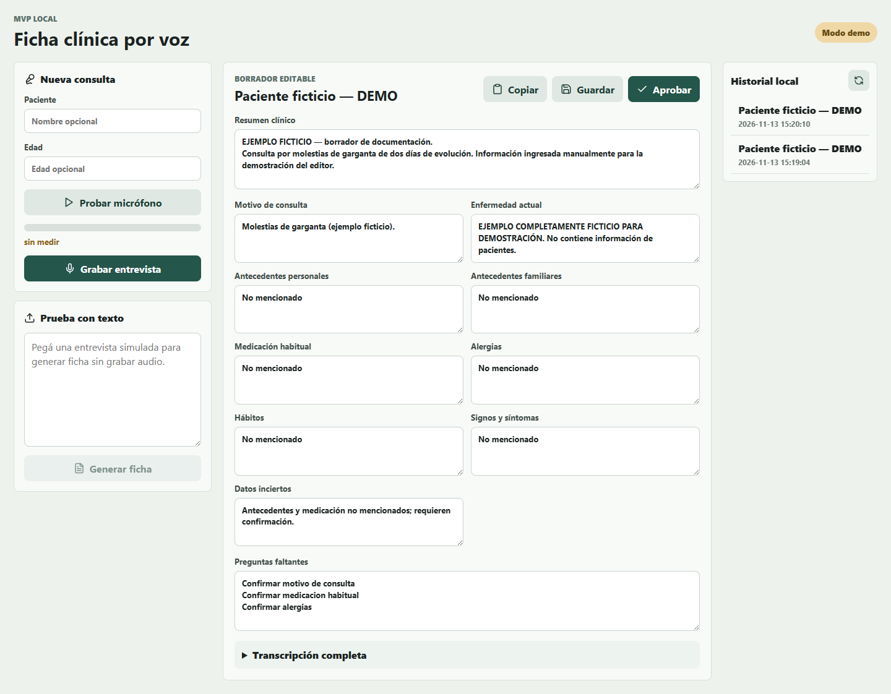

# Voice Clinical Notes

Personal full-stack prototype by **Federico Pucci** for turning a recorded interview into an editable clinical note draft.

**React · Node.js 22+ · Express · SQLite · OpenAI / Azure Speech · FFmpeg**



## What it does

- Records microphone audio in the browser and uploads 45-second chunks.
- Transcribes audio through OpenAI or Azure Speech when configured.
- Generates a draft note, structured fields and follow-up questions.
- Lets the user edit the draft, save it and review previous consultations.
- Stores consultations locally in SQLite; recordings stay in `uploads/`.

This is a local development MVP for documentation assistance. Drafts require professional review; the application does not diagnose. Authentication and production deployment are outside the current scope.

## Try it without API credentials

Requirements: Node.js **22 or newer** and npm.

```bash
npm ci
npm run dev
```

Open http://127.0.0.1:5173. The local API runs at http://127.0.0.1:3001.

Paste the fictional transcript from [`examples/synthetic-transcript.txt`](examples/synthetic-transcript.txt) to exercise the save/edit/history flow. Without credentials, the backend returns clearly labeled demo content: it does not perform real transcription or model inference.

## Enable real AI processing

Copy `.env.example` to `.env` and configure a provider:

- **OpenAI:** set `OPENAI_API_KEY`.
- **Azure:** set `AI_PROVIDER=azure` and the `AZURE_SPEECH_*` and `AZURE_OPENAI_*` values documented in `.env.example`.

The UI and API run locally. When AI processing is enabled, audio or text is sent to the configured provider.

## Build

```bash
npm run build
```

The Vite output is written to `dist/`. `npm run dev` is the documented way to run both frontend and backend for this prototype.

## Architecture

```text
Browser / React
  └─ recording, draft editor, history
          │ HTTP / multipart
Express API
  ├─ AI provider adapter and audio conversion
  ├─ draft generation
  └─ SQLite consultation storage
```

## Repository contents

`src/` contains the UI; `server/` contains the API, storage and AI integration. The repository includes only source and a synthetic example. Local `.env`, databases, uploaded recordings, dependencies and build output are ignored.

## Author

[Federico Pucci](https://github.com/FedePucci1). This is a personal project, separate from the academic team projects in my portfolio.
